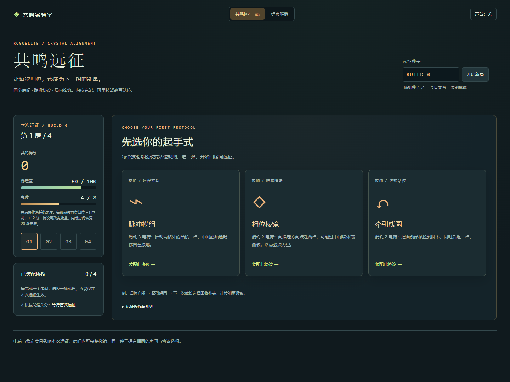

# 晶核归位 · 共鸣远征

把推箱解谜与局内构筑结合：**归位充能 → 技能改变站位 → 随机协议形成联动。**

**[在线试玩](https://wangdi999.github.io/crystal-alignment/?mode=expedition) · [经典六关](https://wangdi999.github.io/crystal-alignment/?mode=classic) · [下载离线版](https://github.com/wangdi999/crystal-alignment/releases/latest)**



## 共鸣远征 v1.1

每次远征有四个房间。开局从牵引、相位步和脉冲中选一个技能；每完成一房，再从三项协议中选一项成长，最终形成四协议构筑。

- **牵引线圈**：把面前晶核拉到脚下，研究员后退，救回墙边站位。
- **相位棱镜**：跃迁两格，越过中间墙体或晶核。
- **脉冲模组**：隔一格推动晶核，研究员留在原位。
- **六项成长协议**：额外充能、技能回收、归位修复、推动减耗、余电修复，以及「技能后接推动」的回声联动。
- **路线取舍**：稳态区平稳推进；过载区入场电荷和通关分更多，但普通推动额外消耗稳定度。选择前可看棋盘预览。
- **种子复玩**：同一种子固定房间与选项；支持每日共鸣、挑战链接、本机成绩和逐步续玩。

每颗晶核在同一房间只结算一次首次归位收益，回声奖励也有单晶核限制。撤销完整恢复位置、资源和联动。房间完成后先确认，再进入下一次成长。

方向键 / WASD 移动，数字键 1 / 2 / 3 选择技能后再选方向；Esc 取消，Z 撤销，Y 重做，H 思路提示。触屏可滑动棋盘或点击方向按钮。

`rogue.js` 为确定性远征规则，`rogue-app.js` 为成长、技能、分享与进度界面。远征采用九个已验证手工模板及旋转／镜像变换，按层抽取。详见 [远征设计记录](docs/远征设计.md)。

## 经典六关

将所有晶核推入圆形目标位。晶核不能拉回，也不能同时推动两颗。方向键 / WASD 移动，Z 撤销，Y 重做，R 重开，H 获取一步提示；触屏可滑动棋盘或点击方向按钮。

原稿三关完整保留，新增三关挑战，最短移动依次为 **1 / 4 / 12 / 15 / 22 / 32**。支持逐关自动续玩、撤销与重做、静态死位提醒、无提示最佳记录、音效开关和手机尺寸布局。

## 本地运行与构建

直接双击 `index.html`，无需安装运行环境或开启服务。离线单文件与 ZIP 在 Releases 下载，解压后用浏览器打开即可。

修改源码后，用 Node.js 20 或更新版本验证并打包：

```sh
npm test
npm run build
```

单文件输出到 `dist/crystal-alignment.html`。可选浏览器验收需要 Python、Playwright 和系统 Chrome：

```sh
python -m pip install playwright
python tools/browser_test.py
python tools/rogue_browser_test.py
python tools/package.py
```

## 验证与归属

总计 30 项规则测试覆盖经典关卡、九模板的八种变换、三种技能、联动与反刷取、存档重放，以及 60 次四房间完整远征。经典模式另有 39 项 Chrome 离线检查；远征四房间真实点击、成长与触屏证据见 `artifacts/rogue-browser-report.json`。这些结果不是多人试玩或真机测试，不代表构筑平衡已经验证。

源码：`engine.js` 为关卡和规则，`app.js` 为交互与存档，`styles.css` 为界面。前三关来自个人策划草案，其余内容为补充设计，代码在 AI 辅助下实现。详见 [作品归属](NOTICE.md)。存档仅保存在本机，不同浏览器或打开路径可能使用不同进度。
