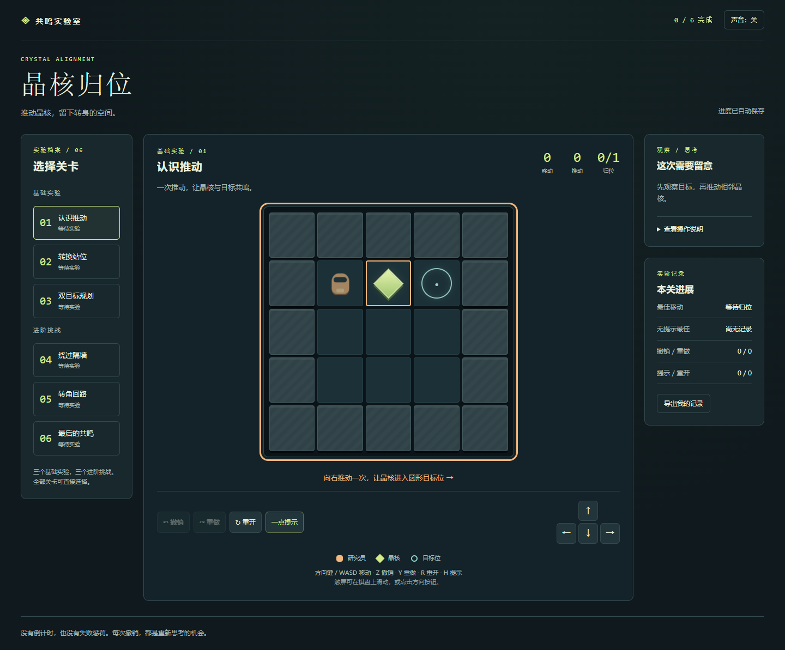

# 晶核归位 · 共鸣实验室

六关推箱解谜游戏，展示规则教学、空间规划和可逆试错。

**[在线试玩](https://wangdi999.github.io/crystal-alignment/) · [下载离线版](https://github.com/wangdi999/crystal-alignment/releases/latest)**



## 玩法与操作

将所有晶核推入圆形目标位。晶核不能拉回，也不能同时推动两颗。方向键 / WASD 移动，Z 撤销，Y 重做，R 重开，H 获取一步提示；触屏可滑动棋盘或点击方向按钮。

原稿三关完整保留，新增三关挑战，最短移动依次为 **1 / 4 / 12 / 15 / 22 / 32**。支持逐关自动续玩、撤销与重做、静态死位提醒、无提示最佳记录、音效开关和手机尺寸布局。

## 本地运行与构建

直接双击 `index.html`，无需安装运行环境或开启服务。离线单文件与 ZIP 在 Releases 下载，解压后用浏览器打开即可。

修改源码后，用 Node.js 20 或更新版本验证并打包：

```sh
npm test
npm run build
```

单文件输出到 `dist/crystal-alignment.html`。可选浏览器验收需要 Python、Playwright 和系统 Chrome：

```sh
python -m pip install playwright
python tools/browser_test.py
python tools/package.py
```

## 验证与归属

13 项规则测试覆盖关卡可解、推动约束、死位识别和合法移动重放。39 项 Chrome 离线自动化检查覆盖全部六关实际操作、存档恢复、触屏模拟和存储不可用时的容错，见 `artifacts/browser-report.json`。这些结果不是多人试玩或真机测试。

源码：`engine.js` 为关卡和规则，`app.js` 为交互与存档，`styles.css` 为界面。前三关来自个人策划草案，其余内容为补充设计，代码在 AI 辅助下实现。详见 [作品归属](NOTICE.md)。存档仅保存在本机，不同浏览器或打开路径可能使用不同进度。
